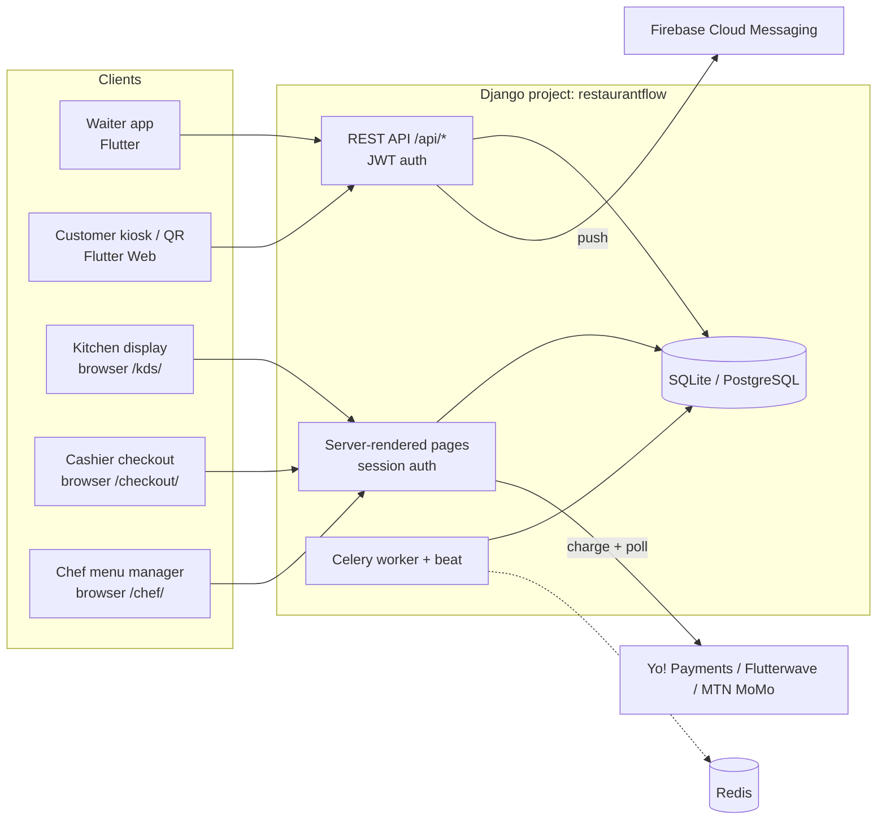
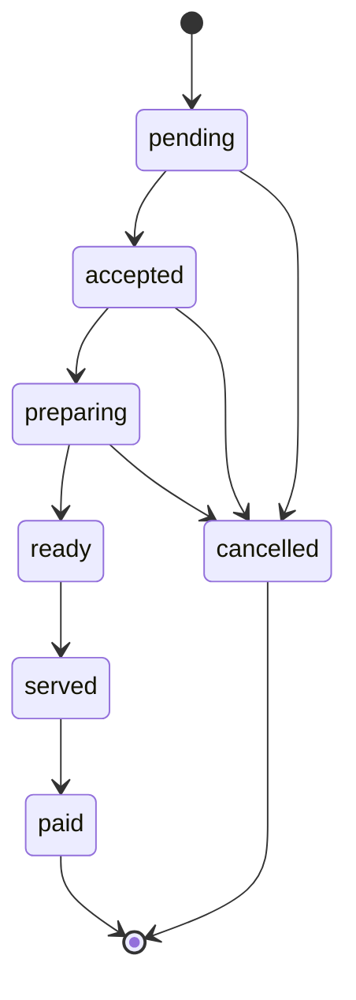
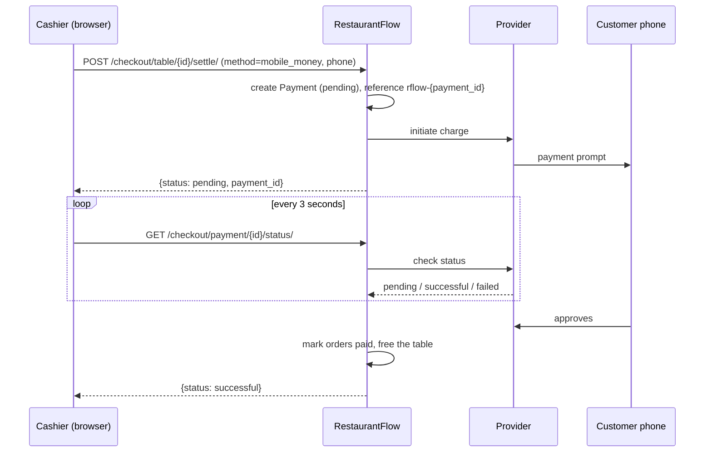
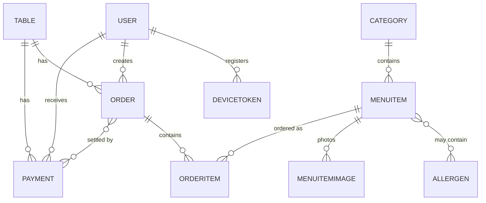

# RestaurantFlow

A restaurant operations backend built with **Django** and **Django REST Framework**. One codebase serves every screen in a restaurant: a JSON API for the waiter and customer apps, plus three server-rendered browser pages for the kitchen, the cashier and the chef, which need no app install, just a browser.

It is built around the way restaurants actually work in Uganda: prices in **UGX**, **mobile money** (MTN MoMo, Airtel, via Yo! Payments, Flutterwave or direct MTN integration), cash with live change calculation, and a menu that includes rolex, matoke and grilled tilapia.

---

## Table of contents

1. [Features](#features)
2. [How it fits together](#how-it-fits-together)
3. [Tech stack](#tech-stack)
4. [Roles and access](#roles-and-access)
5. [Project structure](#project-structure)
6. [Getting started](#getting-started)
7. [Configuration](#configuration)
8. [Browser interfaces](#browser-interfaces)
9. [REST API reference](#rest-api-reference)
10. [Order lifecycle](#order-lifecycle)
11. [Payments](#payments)
12. [Background jobs](#background-jobs)
13. [Push notifications](#push-notifications)
14. [Data model](#data-model)
15. [Management commands and scripts](#management-commands-and-scripts)
16. [Testing](#testing)
17. [Flutter integration notes](#flutter-integration-notes)
18. [Going to production](#going-to-production)
19. [Known issues and limitations](#known-issues-and-limitations)
20. [Troubleshooting](#troubleshooting)

---

## Features

- **Role-based staff accounts**: admin, waiter, kitchen and cashier, with JWT authentication for apps and session login for the browser pages.
- **Table management** with live status (`available`, `occupied`, `awaiting_payment`) and a unique QR token per table.
- **Menu management**: categories, items, allergens, and multiple photos per item.
- **Ordering** from the waiter app, a customer kiosk or QR self-order, with price snapshots taken at order time.
- **Per-item kitchen workflow**: each dish moves through `pending → preparing → ready → served`, and the parent order's status is derived automatically.
- **Kitchen Display System (KDS)**: a live-updating board in the browser.
- **Cashier checkout** in the browser: itemised bills, cash with change calculation, card recording, and mobile money with automatic confirmation polling.
- **Chef menu manager** in the browser: add, edit and delete meals, upload photos, and toggle availability for "we're out of X today".
- **Pluggable mobile money**: switch between Yo! Payments, Flutterwave and direct MTN MoMo by changing one environment variable.
- **Walkout detection**: a Celery job flags tables whose food was served 30+ minutes ago with no payment.
- **Push notifications** to staff devices through Firebase Cloud Messaging, degrading gracefully when it is not configured.
- **Server-enforced state machine**: illegal order transitions are rejected with a `400`.

---

## How it fits together



A typical order:

1. A waiter (or kiosk) posts an order to `/api/orders/`. The table becomes `occupied` and the kitchen is notified.
2. The kitchen sees it on the **KDS** and taps *Start Preparing* and *Mark Ready* per dish. Waiters are notified when a dish is ready.
3. The waiter serves the dish. When every item is served the order becomes `served`.
4. At the **checkout** page the cashier settles the table's bill with cash, card or mobile money. Orders become `paid` and the table is freed.

---

## Tech stack

| Area | Technology |
|---|---|
| Framework | Django 4.2 (pinned `>=4.2,<5.0`), Django REST Framework |
| Auth | `djangorestframework-simplejwt` (APIs), Django sessions (browser pages) |
| Database | SQLite by default, PostgreSQL ready (`psycopg2-binary`) |
| Background jobs | Celery 5 with Redis |
| Push notifications | `firebase-admin` (FCM) |
| Image uploads | Pillow |
| Config | `python-decouple` (`.env`) |
| CORS | `django-cors-headers` |
| Mobile money | `requests`, `xmltodict` (Yo! Payments speaks XML) |

---

## Roles and access

There are four roles, stored on `accounts.User.role`. **Admin passes every role check.**

| Role | Typical user | Can do |
|---|---|---|
| `admin` | Owner / manager | Everything, including creating staff, tables, menu entries |
| `waiter` | Floor staff | Place orders, serve items, view tables and menu |
| `kitchen` | Kitchen / chef | Start and ready items, KDS page, chef menu manager |
| `cashier` | Cashier | Checkout page, payments API |

Browser pages enforce their own role check on top of login:

| Page | Allowed roles |
|---|---|
| `/kds/` | `kitchen`, `admin` |
| `/chef/` | `kitchen`, `admin` |
| `/checkout/` | `cashier`, `admin` |

---

## Project structure

Run everything from the directory that contains `manage.py`.

```
.
├── manage.py
├── requirements.txt
├── .env.example               # template for your .env
├── seed.py                    # sample data loader
│
├── restaurantflow/            # Django project package
│   ├── settings.py
│   ├── urls.py                # root URL routing
│   ├── celery.py              # Celery app + beat schedule
│   ├── wsgi.py / asgi.py
│
├── accounts/                  # custom User (role), JWT login, role permissions
├── restaurant/                # Table model (number, capacity, status, qr_token)
├── menu/                      # Category, MenuItem, MenuItemImage, Allergen
├── orders/                    # Order + OrderItem, state machine, Celery task
│   └── management/commands/fix_stuck_order_statuses.py
├── payments/                  # Payment model, mobile money providers
│   ├── mobile_money.py        # single entry point; picks the provider
│   ├── yo_payments.py         # Yo! Payments (default)
│   ├── flutterwave.py         # Flutterwave
│   ├── mtn_momo.py            # direct MTN MoMo
│   └── management/commands/provision_mtn_momo.py
├── notifications/             # FCM device tokens + notify_role()
├── kds/                       # Kitchen display (templates + views)
├── checkout/                  # Cashier checkout (templates + views)
├── chef/                      # Chef menu manager (templates + views)
│
├── test_api.py                # end-to-end API tests
├── test_checkout.py
├── test_checkout_payments.py  # cash, mobile money, MTN (providers mocked)
├── test_chef.py
├── test_kds.py
└── test_order_sync_bug.py
```

> **Housekeeping note.** The archive this README was written against also contains stale duplicate copies of parts of the project, for example a project folder nested inside `notifications/` and `restaurantflow/`, apps nested inside `restaurant/`, and loose `models.py` / `views.py` / `urls.py` files at the top level. Django does not load any of them. A check of the live app paths confirmed that each app resolves to its own top-level folder shown above. They are safe to delete (after a backup or a commit) and removing them will avoid confusion.

---

## Getting started

### Prerequisites

- Python 3.10+ (tested on 3.12)
- Redis, only if you want background jobs (walkout detection)
- A Firebase service account, only if you want push notifications

### 1. Install

```bash
python -m venv venv
source venv/bin/activate          # Windows: venv\Scripts\activate
pip install -r requirements.txt
cp .env.example .env              # then edit .env
```

### 2. Create the database and load sample data

```bash
python manage.py migrate
python seed.py
```

`seed.py` is safe to re-run. It creates 5 staff accounts, 12 tables (tables 1 to 8 seat 4, tables 9 to 12 seat 6), 9 allergens, 3 categories and 19 menu items.

**Default accounts** (password for all: `pass1234`, change these before real use)

| Username | Role |
|---|---|
| `admin` | admin |
| `waiter1`, `waiter2` | waiter |
| `kitchen` | kitchen |
| `cashier` | cashier |

### 3. Run the server

```bash
python manage.py runserver
```

| What | URL | Login |
|---|---|---|
| Django admin | http://localhost:8000/admin/ | `admin` |
| Kitchen display | http://localhost:8000/kds/ | `kitchen` |
| Cashier checkout | http://localhost:8000/checkout/ | `cashier` |
| Chef menu manager | http://localhost:8000/chef/ | `kitchen` or `admin` |
| REST API | http://localhost:8000/api/ | JWT, see [REST API reference](#rest-api-reference) |

> To create the Django admin superuser login you can also run `python manage.py createsuperuser`; the seeded `admin` user has role `admin` but is not flagged as a Django superuser unless you make it one.

### 4. Background workers (optional)

Needed only for walkout detection. Push notifications fire from the request itself, not from Celery.

```bash
# Terminal 2: worker
celery -A restaurantflow worker -l info

# Terminal 3: scheduler
celery -A restaurantflow beat -l info
```

On Windows, start the worker with `-P solo`: `celery -A restaurantflow worker -l info -P solo`.

---

## Configuration

Settings are read from `.env` via `python-decouple` (real environment variables take precedence over `.env`).

| Variable | Default | Purpose |
|---|---|---|
| `DEBUG` | `True` | Debug mode. Also turns on `CORS_ALLOW_ALL_ORIGINS` and media serving |
| `SECRET_KEY` | insecure dev default | Django secret key. **Set your own** outside local dev |
| `REDIS_URL` | `redis://localhost:6379/0` | Celery broker and result backend |
| `FCM_CREDENTIALS_PATH` | none | Path to a Firebase service-account JSON |
| `MOBILE_MONEY_PROVIDER` | `yo_payments` | `yo_payments`, `flutterwave` or `direct` |
| `YO_PAYMENTS_API_USERNAME` | empty | Yo! Payments API username (separate from your portal login) |
| `YO_PAYMENTS_API_PASSWORD` | empty | Yo! Payments API password |
| `YO_PAYMENTS_USE_PRODUCTION` | `False` | `True` switches from the sandbox URL to the live one |
| `MTN_MOMO_SUBSCRIPTION_KEY` | empty | Collections product Primary Key from momodeveloper.mtn.com |
| `MTN_MOMO_API_USER` | empty | Printed by `provision_mtn_momo` |
| `MTN_MOMO_API_KEY` | empty | Printed by `provision_mtn_momo` |
| `MTN_MOMO_ENV` | `sandbox` | `sandbox` or `production` |
| `MTN_MOMO_CURRENCY` | `EUR` | Sandbox only accepts `EUR`. Change to `UGX` after Go-Live (confirm the code with MTN) |
| `MTN_MOMO_CALLBACK_HOST` | empty | Callback host used when provisioning the API user |
| `MTN_MOMO_PRODUCTION_BASE_URL` | empty | Given to you by MTN during Go-Live |
| `FLUTTERWAVE_SECRET_KEY` | empty | Flutterwave secret key |
| `FLUTTERWAVE_PUBLIC_KEY` | empty | Flutterwave public key |
| `FLUTTERWAVE_WEBHOOK_HASH` | empty | Must match the hash set in the Flutterwave dashboard |

Other fixed settings worth knowing: timezone `Africa/Kampala`; JWT access token lifetime 8 hours, refresh token 7 days; API pagination of 50 per page; uploaded media goes to `media/`.

> **`.env.example` lists `DB_NAME`, `DB_USER`, `DB_PASSWORD`, `DB_HOST`, `DB_PORT` and `CORS_ALLOWED_ORIGINS`, but `settings.py` does not read them as shipped.** See [Going to production](#going-to-production) for how to switch to PostgreSQL and restrict CORS.

---

## Browser interfaces

All three are plain Django pages with session login, so you can point a spare PC and monitor at them. No Flutter app is involved.

### Kitchen display, `/kds/`

Plug a monitor into a cheap PC, open Chrome in kiosk mode on `http://<server-ip>:8000/kds/`, log in once as `kitchen`, and leave it open.

- Shows every order that is not `served`, `paid` or `cancelled`, oldest first.
- Refreshes itself every **5 seconds**.
- *Start Preparing* and *Mark Ready* update in place with no page reload.
- Marking an item ready notifies waiters (push).

### Cashier checkout, `/checkout/`

Shows every table with an open bill, the itemised breakdown, and a payment method selector. It refreshes every 5 seconds.

- **Settle Bill** is disabled until **every order on the table is `served`**, so a customer can't be charged for food still cooking. The server enforces this too.
- **Cash**: enter the amount handed over. Change is calculated live as you type, and the server rejects amounts below the bill.
- **Card**: recorded manually (there is no card terminal integration).
- **Mobile money**: enter the customer's phone number. A payment prompt is sent to their phone, the page polls every **3 seconds**, and on approval the orders are marked paid and the table is freed. A second settle attempt is blocked while one is pending, so a table cannot be double-charged.
- With `MOBILE_MONEY_PROVIDER=direct` the cashier must also pick **MTN or Airtel**.

### Chef menu manager, `/chef/`

Lets the chef manage the menu without touching the admin:

- **Add a meal**: name, description, price, category, allergens, and several photos at once.
- **Edit a meal**: change any field, add photos, or remove individual photos.
- **Delete a meal** and its photos.
- **Toggle availability** without deleting, for "we're out of X today".

Changes appear immediately in the API (same `MenuItem` table), including a `photos` array of absolute image URLs on each item.

---

## REST API reference

Base URL: `http://localhost:8000/api/`

**Authentication.** Log in to get a JWT, then send it on every request:

```bash
curl -X POST http://localhost:8000/api/auth/login/ \
  -H "Content-Type: application/json" \
  -d '{"username": "waiter1", "password": "pass1234"}'
# → {"refresh": "...", "access": "..."}

curl http://localhost:8000/api/tables/ -H "Authorization: Bearer <access>"
```

**Pagination.** List endpoints return `{"count", "next", "previous", "results": [...]}` with 50 results per page. Clients must read `results`.

### Endpoints

"Any" means any authenticated user.

#### Auth

| Method | Endpoint | Who | Description |
|---|---|---|---|
| POST | `/api/auth/login/` | Public | Get access and refresh tokens |
| POST | `/api/auth/login/refresh/` | Public | Exchange a refresh token for a new access token |
| GET | `/api/auth/me/` | Any | Current user |
| POST | `/api/auth/register/` | Admin | Create a staff account |
| GET | `/api/auth/staff/` | Admin | List all staff |

#### Tables

| Method | Endpoint | Who | Description |
|---|---|---|---|
| GET | `/api/tables/` | Any | List tables with status, `qr_token` and `unpaid_total` |
| GET | `/api/tables/{id}/` | Any | Table detail |
| POST / PUT / PATCH / DELETE | `/api/tables/…` | Admin | Structural changes to the floor plan |

#### Menu

| Method | Endpoint | Who | Description |
|---|---|---|---|
| GET | `/api/categories/` | Any | Categories with nested items |
| GET | `/api/items/` | Any | All menu items (with `allergens` and `photos`) |
| GET | `/api/allergens/` | Any | All allergens |
| POST / PUT / PATCH / DELETE | `/api/categories/`, `/api/items/`, `/api/allergens/` | Admin | Manage the menu. Use `allergen_ids` to set allergens on an item |

#### Orders

| Method | Endpoint | Who | Description |
|---|---|---|---|
| POST | `/api/orders/` | Any | Place an order |
| GET | `/api/orders/` | Any | List orders. Filters: `?table=<id>`, `?active=true` |
| GET | `/api/orders/{id}/` | Any | Order with items and total |
| POST | `/api/orders/{id}/accept/` | Waiter / admin | `pending → accepted` |
| POST | `/api/orders/{id}/cancel/` | Waiter / admin | Cancel from `pending`, `accepted` or `preparing` |
| PUT / PATCH / DELETE | `/api/orders/{id}/` | Waiter / admin | Edit notes and so on. `status` is read-only here |

Place an order:

```bash
curl -X POST http://localhost:8000/api/orders/ \
  -H "Authorization: Bearer <access>" -H "Content-Type: application/json" \
  -d '{
    "table": 3,
    "channel": "waiter",
    "customer_name": "Sarah",
    "notes": "",
    "items_write": [
      {"menu_item": 2, "quantity": 2, "notes": "no onions"},
      {"menu_item": 4, "quantity": 1}
    ]
  }'
```

`channel` is one of `waiter` (default), `kiosk` or `qr`. Unit prices are copied from the menu at order time, so later price changes never alter existing orders. Placing an order moves an `available` table to `occupied` and notifies the kitchen.

#### Order items (kitchen and floor)

| Method | Endpoint | Who | Description |
|---|---|---|---|
| GET | `/api/order-items/` | Any | List items (read-only). `?kitchen_queue=true` excludes served and cancelled. Items are created via `POST /api/orders/` |
| POST | `/api/order-items/{id}/start_preparing/` | Kitchen / admin | Item → `preparing` |
| POST | `/api/order-items/{id}/mark_ready/` | Kitchen / admin | Item → `ready`, notifies waiters |
| POST | `/api/order-items/{id}/serve/` | Waiter / admin | Item → `served` |

These three actions are the only way to change an item's status, and each re-derives the parent order's status.

#### Payments

| Method | Endpoint | Who | Description |
|---|---|---|---|
| POST | `/api/payments/` | Cashier / admin | Settle one or more **served** orders for one table (`cash` or `card`) |
| GET | `/api/payments/`, `/api/payments/{id}/` | Cashier / admin | Payment history (read-only: payments cannot be edited or deleted) |

```bash
curl -X POST http://localhost:8000/api/payments/ \
  -H "Authorization: Bearer <access>" -H "Content-Type: application/json" \
  -d '{"table": 3, "order_ids": [12, 13], "amount": "41000.00", "method": "cash"}'
```

Validation: at least one order; every order must belong to the table and be `served`; `amount` must exactly equal the orders' total. On success the orders become `paid`, and the table is freed if nothing else is unpaid. `mobile_money` is rejected on this endpoint with a `400`; mobile money must go through the [checkout page](#cashier-checkout-checkout) flow, which sends the charge and waits for provider confirmation.

#### Notifications

| Method | Endpoint | Who | Description |
|---|---|---|---|
| POST | `/api/notifications/register-device/` | Any | Register an FCM token: `{"token": "...", "platform": "android"}` |

---

## Order lifecycle

### Order states



Deliberate user actions (accept, cancel, payment) go through `Order.transition_to()`, which rejects illegal jumps such as `pending → paid` with a `400`.

### Item states

`pending → preparing → ready → served`, or `cancelled`. Each dish moves on its own, so a starter can be served while the main is still cooking.

### How the order's status follows its items

The order status is **derived** from its non-cancelled items by `Order.sync_status_from_items()` after every item change:

| Items | Order becomes |
|---|---|
| All `served` | `served` |
| All `ready` or `served` (mixed) | `ready` |
| Any `preparing`, `ready` or `served` (otherwise) | `preparing` |
| All still `pending` | unchanged (accepting is a deliberate waiter action) |

This derivation can jump several steps at once (for example `pending → served` if the kitchen and waiter outpace anyone tapping Accept), and it never touches `paid` or `cancelled` orders. If you ran an older version that lacked this logic, see [`fix_stuck_order_statuses`](#management-commands-and-scripts).

### Table states

`available → occupied` when the first order is placed; `occupied → awaiting_payment` when the [walkout job](#background-jobs) flags it; back to `available` once every order on the table is paid or cancelled and a payment completes.

---

## Payments

Every payment records the table, the orders it settles (one payment can cover several orders), the amount, method, status and who received it.

| Method | Status behaviour |
|---|---|
| `cash` | Instant `successful`. Stores `amount_tendered` and `change_given` |
| `card` | Instant `successful`, recorded manually (no terminal integration) |
| `mobile_money` | Starts `pending`, becomes `successful` or `failed` when the provider confirms |

### Mobile money flow



The checkout code never calls a provider directly. It goes through `payments/mobile_money.py`, which reads `MOBILE_MONEY_PROVIDER` on every call, so switching providers is a `.env` change plus a restart.

### Providers

#### `yo_payments` (default)

Aggregator, network-agnostic, no per-network setup.

1. Sign up for a **business** account at https://payments.yo.co.ug (personal accounts cannot use the API).
2. In the dashboard, open **API Access** and copy the **API Username** and **API Password** (separate from your portal login).
3. Set `YO_PAYMENTS_API_USERNAME` and `YO_PAYMENTS_API_PASSWORD` in `.env` and restart.
4. Sandbox works immediately. When ready for real money set `YO_PAYMENTS_USE_PRODUCTION=True`.

Charges use non-blocking mode (so a worker is not held for the customer's 30 to 90 seconds) and the checkout page polls for the outcome. Until credentials are set, a mobile money attempt shows a clear setup message instead of crashing. Cash and card keep working.

#### `flutterwave`

Aggregator. Built and tested with mocked calls; set `FLUTTERWAVE_SECRET_KEY` (a TEST key auto-confirms Uganda mobile money charges after a few seconds). An optional webhook exists at `/checkout/webhook/flutterwave/` (needs a public URL and `FLUTTERWAVE_WEBHOOK_HASH`); it finds the payment from the `rflow-<payment id>` reference.

#### `direct`

Straight to the networks, no aggregator and no middleman fee, but each network is its own integration.

- **MTN MoMo: built.**
  1. Subscribe to the **Collections** product at https://momodeveloper.mtn.com and copy the Primary Key into `MTN_MOMO_SUBSCRIPTION_KEY`.
  2. Run `python manage.py provision_mtn_momo` **once**. It creates an API user and key and prints `MTN_MOMO_API_USER` and `MTN_MOMO_API_KEY` to add to `.env`.
  3. The sandbox accepts only `EUR`, so `MTN_MOMO_CURRENCY` defaults to `EUR`. Switch to `UGX` (confirm the code with MTN) after Go-Live approval, and set `MTN_MOMO_PRODUCTION_BASE_URL` and `MTN_MOMO_ENV=production`.
  4. Local phone formats are normalised to international format before the request.
  5. **Sandbox test numbers.** Any number that is not special auto-succeeds after a short delay. To force an outcome:

     | Number | Outcome |
     |---|---|
     | `46733123450` | Payment fails |
     | `46733123451` | Rejected by customer |
     | `46733123452` | Expires (customer never responds) |
     | `46733123455` | Payer not found |
     | `46733123461` | Internal processing error |

- **Airtel Money: not built yet.** Selecting Airtel in `direct` mode returns a clear "not built yet" message. Sign up at https://developers.airtel.africa to wire up `payments/airtel_money.py`.

### Settlement rules (checkout page)

- Every unpaid order on the table must be `served`.
- A table with a `pending` payment cannot start another.
- Cash must cover the total; change is stored on the payment.
- A successful payment marks all included orders `paid` and frees the table if nothing else is unpaid.

---

## Background jobs

Celery beat runs `orders.tasks.flag_stale_orders` **every 2 minutes**. It finds orders that have been `served` and untouched for **30+ minutes** and sets their table to `awaiting_payment`, giving the cashier and waiters a visual flag for a likely walkout or a slow cashier. Requires Redis, a worker and beat. The rest of the system works without it.

---

## Push notifications

`notifications.services.notify_role(role, title, body, data)` sends an FCM push to every device registered by users with that role.

| Event | Who is notified |
|---|---|
| New order placed | Kitchen |
| Item marked ready | Waiters |

Devices register with `POST /api/notifications/register-device/`. To enable, set `FCM_CREDENTIALS_PATH` to a Firebase service-account JSON (Firebase Console → Project Settings → Service Accounts). If nothing is configured, or no devices are registered, notifications are skipped. A failed push is logged and never breaks the request that triggered it (for example placing an order).

---

## Data model



| Model | Key fields |
|---|---|
| `accounts.User` | Django `AbstractUser` plus `role` |
| `restaurant.Table` | `number` (unique), `capacity`, `status`, `qr_token` (UUID, unique), `unpaid_total` (computed) |
| `menu.Category` | `name`, `sort_order` |
| `menu.MenuItem` | `category`, `name`, `description`, `price`, `available`, `allergens`, legacy `image_url` |
| `menu.MenuItemImage` | `menu_item`, `image`, `uploaded_at` (first upload acts as the cover photo) |
| `menu.Allergen` | `name` |
| `orders.Order` | `table`, `channel`, `status`, `customer_name`, `notes`, `created_by`, timestamps, `total` (computed) |
| `orders.OrderItem` | `order`, `menu_item`, `quantity`, `unit_price` (snapshot), `notes`, `status`, `subtotal` (computed) |
| `payments.Payment` | `table`, `orders` (many), `amount`, `method`, `status`, `amount_tendered`, `change_given`, `provider`, `provider_reference`, `network`, `phone_number`, `received_by`, `paid_at` |
| `notifications.DeviceToken` | `user`, `token` (unique), `platform` |

---

## Management commands and scripts

| Command | When to run |
|---|---|
| `python seed.py` | Load sample users, tables, allergens and menu. Safe to re-run |
| `python manage.py provision_mtn_momo` | **Once**, to create the MTN MoMo API user and key (sandbox) |
| `python manage.py fix_stuck_order_statuses` | One-time repair for orders left with a stale status (for example `accepted` while every item is `served`) from before the status-derivation fix. Safe to run any time: it only touches active orders whose derived status differs, and never modifies `paid` or `cancelled` ones |

---

## Testing

```bash
python manage.py test test_api test_checkout test_checkout_payments test_chef test_kds test_order_sync_bug test_security
```

Name the modules explicitly: a bare `python manage.py test` would also pick up any stale duplicate test files if they are still in the tree.

Result against a clean install of the pinned requirements (Django 4.2.30): **43 tests, all passing.**

| Module | Covers |
|---|---|
| `test_api.py` | Auth and roles, menu, full order lifecycle, kitchen cannot access payments, tables, admin-only table creation |
| `test_checkout.py` | Cashier-only login, full settle flow, unserved orders cannot be settled |
| `test_checkout_payments.py` | Cash change, mobile money pending/success/decline/double-charge guard, MTN direct mode, MTN request format |
| `test_chef.py` | Role gating, create/edit/delete meals and photos, price validation |
| `test_kds.py` | Login required, waiter blocked, full kitchen flow |
| `test_order_sync_bug.py` | Orders no longer get stuck; finalised orders never resurrected; repair command |
| `test_security.py` | Role checks on accept/cancel, read-only order items and payments, mobile money rejected on the REST endpoint, push failures don't break orders, Flutterwave webhook |

Mobile money providers are **mocked**, so these tests make no network calls. Test the real sandbox HTTP calls yourself once you have keys.

---

## Flutter integration notes

### Login

```dart
final response = await dio.post('/api/auth/login/', data: {
  'username': username,
  'password': password,
});
final token = response.data['access'];
// Store securely and send on every request:
// Authorization: Bearer <token>
```

Refresh with `/api/auth/login/refresh/` before the 8-hour access token expires. Remember list responses are paginated: read `response.data['results']`.

### QR ordering (customer kiosk)

Each table has a unique `qr_token`. Encode it in a QR code such as `https://yourapp.com/order?token=<qr_token>`. The API does **not** currently provide a lookup by token or an unauthenticated ordering endpoint. Today the kiosk must call `/api/tables/` as a logged-in service account and match `qr_token` client-side, then post orders with `"channel": "qr"`. Adding a `?qr_token=` filter and a scoped public endpoint is recommended before launch.

### Real-time updates

The API is REST-only. Poll (the KDS uses a 5 second loop), or add Django Channels / WebSockets later. FCM push already covers "new order" and "item ready".

---

## Going to production

This codebase ships configured for local development. Before real customers use it, work through this list.

- [ ] **Secrets.** Set a strong `SECRET_KEY`, `DEBUG=False`, and a real `ALLOWED_HOSTS` (currently `['*']`).
- [ ] **Database.** Switch to PostgreSQL. In `settings.py`, comment out the SQLite block and uncomment the PostgreSQL block, set `DB_NAME`, `DB_USER`, `DB_PASSWORD`, `DB_HOST`, `DB_PORT` in `.env`, then run `python manage.py migrate` and `python seed.py`.
- [ ] **CORS.** With `DEBUG=False`, `CORS_ALLOW_ALL_ORIGINS` turns off and **no origin is allowed**, because `CORS_ALLOWED_ORIGINS` is not wired into `settings.py`. Add it (comma-separated origins) or Flutter Web clients will be blocked.
- [ ] **App server and static files.** Add a production server (for example gunicorn) and static-file handling (`STATIC_ROOT`, `collectstatic`, WhiteNoise or a web server). None is configured, and the browser pages and Django admin need static files when `DEBUG=False`.
- [ ] **Media.** Uploaded menu photos are saved to local `media/` and served by Django only when `DEBUG=True`. On hosts with an ephemeral filesystem (many free tiers), use external object storage or photos will disappear on redeploy.
- [ ] **Redis and Celery** if you want walkout detection, run a worker and beat as separate processes.
- [ ] **Mobile money.** Move providers out of sandbox (`YO_PAYMENTS_USE_PRODUCTION=True`, or MTN Go-Live and `MTN_MOMO_CURRENCY=UGX`).
- [ ] **Accounts.** Change every seeded password from `pass1234`.
- [ ] **Review [Known issues](#known-issues-and-limitations)** for the remaining limitations.

The archive this README was written against contains no deployment files (no Render or Procfile config, no `DEPLOYMENT.md`, and no bootstrap-admin command), so this section is generic guidance rather than a record of a specific deployment.

---

## Known issues and limitations

None of these block local development; the first two matter before production.

1. **Configuration is not fully wired.** `.env.example` documents `DB_*` and `CORS_ALLOWED_ORIGINS`, which `settings.py` does not read as shipped (see [Going to production](#going-to-production)).
2. **Django version.** Migrations were generated with Django 6.0.6 but `requirements.txt` pins `<5.0`. Everything passes on 4.2.30; align the two deliberately (pin to what you develop on, or bump the pin).
3. **No customer-facing unauthenticated ordering** and no table lookup by `qr_token` (see [Flutter notes](#qr-ordering-customer-kiosk)).
4. **Airtel direct integration is not built**, and card payments are recorded manually.
5. **The `/api/` root page lists only `tables`**, since several routers are mounted at the same prefix. Use the endpoint tables above as the reference.

---

## Troubleshooting

| Symptom | Likely cause and fix |
|---|---|
| Mobile money says "Select MTN or Airtel" | `MOBILE_MONEY_PROVIDER=direct` is set. Choose a network, or set `yo_payments` |
| Mobile money shows a setup message | Provider credentials are empty. Fill the matching variables in `.env` and restart |
| "Settle Bill" is disabled | At least one order on that table is not `served` yet |
| Order stuck at `accepted` though all items are served | Run `python manage.py fix_stuck_order_statuses` |
| Photos upload but don't display | `DEBUG=False` (Django stops serving `media/`), or an ephemeral filesystem wiped them |
| Flutter Web gets CORS errors in production | `CORS_ALLOWED_ORIGINS` is not wired in `settings.py` (see above) |
| Walkout flag never appears | Redis, the Celery worker or beat is not running |
| `ModuleNotFoundError` / odd imports | You are not in the directory containing `manage.py`, or a stale duplicate folder is shadowing a package |
| Login works for API but a browser page bounces you back to login | The account's role isn't allowed on that page (see [Roles and access](#roles-and-access)) |

---

## Security notes

- Never commit `.env`. It is listed in `.gitignore`, but the archive this README was written against included a populated `.env` (MTN sandbox credentials) plus `db.sqlite3` and uploaded media. If it was shared or pushed anywhere, rotate those keys and keep the file out of version control.
- Change all seeded passwords and set a unique `SECRET_KEY` before exposing the app beyond your machine.
- The Flutterwave webhook authenticates with the `verif-hash` header, so keep `FLUTTERWAVE_WEBHOOK_HASH` secret and set it if you use that provider.
